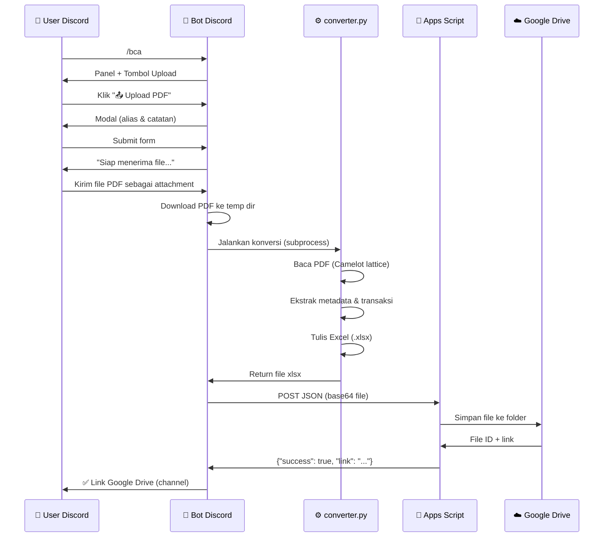

# 📒 UltraJurnal.bot — Dokumentasi

Bot Discord untuk mengkonversi PDF mutasi rekening BCA menjadi file Excel (.xlsx) dan mengupload hasilnya ke Google Drive secara otomatis.

---

## 📁 Struktur Proyek

```
converter/
├── discord_bot.py        # Kode utama bot Discord
├── converter.py          # Engine konversi PDF → Excel
├── gdrive_upload.gs      # Google Apps Script untuk upload ke GDrive
├── run_discord_bot.sh    # Script untuk menjalankan bot (double-click)
├── run_converter.sh      # Script untuk menjalankan converter manual
├── pyproject.toml        # Konfigurasi dependensi Python (uv)
├── deploy_vps.sh         # Script deployment bot ke VPS (systemd)
├── ultrajurnal-bot.service # Template file systemd service
├── .env                  # Variabel environment (JANGAN di-commit ke Git!)
├── .env.example          # Template .env
└── Hasil/                # Folder output file Excel (dibuat otomatis)
```

---

## ⚙️ Prasyarat

| Kebutuhan                              | Keterangan                                                                     |
| -------------------------------------- | ------------------------------------------------------------------------------ |
| Python ≥ 3.10                         | Wajib                                                                          |
| [`uv`](https://github.com/astral-sh/uv) | Package manager Python                                                         |
| Systemd                                | Wajib untuk deployment VPS/Server (otomatis dikonfigurasi script)              |
| Bot Discord                            | Token dari [Discord Developer Portal](https://discord.com/developers/applications) |
| Google Apps Script                     | URL Web App dari deploy `gdrive_upload.gs`                                   |

### Install `uv`

```bash
curl -LsSf https://astral.sh/uv/install.sh | sh
```

---

## 🖥️ Setup Pertama Kali di Server (VPS/Linux)

> Panduan ini untuk deploy bot ke server fresh (Ubuntu/Debian) menggunakan Systemd. Jalankan sekali saja.

### Langkah 1 — Clone Repositori

```bash
git clone https://github.com/SuperfoodTech/UltraJurnal-bot.git
cd UltraJurnal-bot
```

### Langkah 2 — Buat File `.env`

```bash
cp .env.example .env
nano .env
```

Isi nilai berikut di dalam `.env`:

```env
# Token bot dari https://discord.com/developers/applications
DISCORD_BOT_TOKEN=token_bot_kamu_di_sini

# URL Web App hasil Deploy dari gdrive_upload.gs
APPSCRIPT_WEBAPP_URL=https://script.google.com/macros/s/.../exec

# Opsional: ID server Discord untuk sync command instan (tanpa ini ~1 jam)
# DISCORD_GUILD_ID=123456789012345678
```

Simpan dengan `Ctrl+O` → `Enter` → `Ctrl+X`.

> **Penting:** Jangan pernah commit file `.env` ke Git!

### Langkah 3 — Setup Google Apps Script

> Langkah ini hanya perlu dilakukan **sekali**.

1. Buka [Google Apps Script](https://script.google.com/) → **New Project**
2. Copy-paste isi file `gdrive_upload.gs` ke editor
3. Ubah variabel `FOLDER_ID` ke ID folder Google Drive tujuan:
   ```js
   var FOLDER_ID = "ID_FOLDER_GDRIVE_KAMU";
   ```
4. Klik **Deploy** → **New Deployment**
5. Pilih: **Type:** Web App • **Execute as:** Me • **Who has access:** Anyone
6. Klik **Deploy**, authorize, lalu **salin URL** yang muncul
7. Tempel URL ke `.env` sebagai nilai `APPSCRIPT_WEBAPP_URL`

### Langkah 4 — Jalankan Script Deployment

Jalankan script untuk menginstal dependensi sistem (termasuk Ghostscript), `uv`, menyiapkan virtual environment, dan mendaftarkan systemd service:

```bash
bash deploy_vps.sh
```

### Langkah 5 — Verifikasi Bot Berjalan

```bash
# Lihat log real-time
sudo journalctl -u ultrajurnal-bot.service -f
```

Output yang diharapkan:

```
10:00:00 [INFO    ] discord_bot — 🚀 Menjalankan UltraJurnal.bot…
10:00:02 [INFO    ] discord_bot — ✅ Slash commands synced: 1 command(s)
10:00:02 [INFO    ] discord_bot — 🤖 Bot online: UltraJurnal.bot#1234 (ID: 123456789)
```

Tekan `Ctrl+C` untuk keluar dari log — **bot tetap berjalan** di background sebagai service.

### Perintah Manajemen Harian

| Perintah | Fungsi |
| -------- | ------ |
| `sudo systemctl start ultrajurnal-bot` | Start bot |
| `sudo systemctl stop ultrajurnal-bot` | Stop bot |
| `sudo systemctl restart ultrajurnal-bot` | Restart bot |
| `sudo systemctl status ultrajurnal-bot` | Cek status service |
| `sudo journalctl -u ultrajurnal-bot.service -f` | Lihat log real-time |
| `git pull && uv sync && sudo systemctl restart ultrajurnal-bot` | Update bot ke versi terbaru |

---

## 🚀 Cara Menjalankan Bot (Lokal)

### Langkah 1 — Konfigurasi `.env`

Salin file template dan isi nilainya:

```bash
cp .env.example .env
```

Edit file `.env`:

```env
# Token bot dari https://discord.com/developers/applications
DISCORD_BOT_TOKEN=token_bot_kamu_di_sini

# URL Web App hasil Deploy dari gdrive_upload.gs
APPSCRIPT_WEBAPP_URL=https://script.google.com/macros/s/.../exec
```

> **Penting:** Jangan pernah commit file `.env` ke Git!

---

### Langkah 2 — Setup Google Apps Script

> Langkah ini hanya perlu dilakukan **sekali**.

1. Buka [Google Apps Script](https://script.google.com/) → **New Project**
2. Copy-paste isi file `gdrive_upload.gs` ke editor
3. Ubah variabel `FOLDER_ID` di baris pertama ke ID folder Google Drive tujuan:
   ```js
   var FOLDER_ID = "ID_FOLDER_GDRIVE_KAMU";
   ```
4. Klik **Deploy** → **New Deployment**
5. Pilih pengaturan:
   - **Type:** Web App
   - **Execute as:** Me
   - **Who has access:** Anyone
6. Klik **Deploy**, authorize akses, lalu **salin URL** yang muncul
7. Tempel URL tersebut ke `.env` sebagai nilai `APPSCRIPT_WEBAPP_URL`

---

### Langkah 3 — Jalankan Bot

#### Cara A — Script Otomatis (Direkomendasikan)

```bash
bash run_discord_bot.sh
```

Atau di file manager: **double-click** file `run_discord_bot.sh` (akan otomatis membuka terminal).

#### Cara B — Manual dengan `uv`

```bash
uv run python discord_bot.py
```

#### Cara C — Python langsung (jika dependensi sudah terinstall)

```bash
python discord_bot.py
```


---

## 🤖 Cara Menggunakan Bot di Discord

```
Alur kerja:
  /bca    →  Klik "📤 Upload PDF"  →  Isi form alias & catatan
          →  Kirim file PDF ke channel  →  Tunggu link Google Drive
```

### Langkah-langkah

| Langkah | Aksi                                                                                  |
| ------- | ------------------------------------------------------------------------------------- |
| 1️⃣   | Ketik `/bca` di channel Discord                                                     |
| 2️⃣   | Klik tombol**📤 Upload PDF Rekening**                                           |
| 3️⃣   | Isi form popup (nama alias & catatan — keduanya opsional), lalu klik**Submit** |
| 4️⃣   | Kirim file**PDF** mutasi rekening BCA ke channel yang sama                      |
| 5️⃣   | Bot memproses otomatis dan mengirimkan **link Google Drive** ke channel |

---

## 🛠️ Fungsi & Komponen Utama

### `discord_bot.py`

| Komponen                   | Tipe           | Keterangan                                                                   |
| -------------------------- | -------------- | ---------------------------------------------------------------------------- |
| `/bca`                   | Slash Command  | Menampilkan panel utama dengan tombol upload                                 |
| `UploadView`             | UI View        | Panel tombol interaktif (persisten setelah restart)                          |
| `📤 Upload PDF Rekening` | Button         | Membuka modal form untuk input alias & catatan                               |
| `❓ Bantuan`             | Button         | Menampilkan panduan penggunaan bot (hanya terlihat oleh pengguna yang klik)  |
| `UploadPDFModal`         | Modal          | Form pop-up input nama alias dan catatan                                     |
| `on_message`             | Event Handler  | Mendeteksi attachment PDF dari user yang sedang dalam status menunggu upload |
| `run_converter()`        | Async Function | Menjalankan `converter.py` sebagai subprocess asinkron                     |
| `upload_via_appscript()` | Async Function | Encode file ke base64, POST ke Google Apps Script Web App, dan menangani redirect 302 dengan retry otomatis jika server sibuk |
| `download_file()`        | Async Function | Mengunduh attachment PDF dari Discord ke direktori temp                      |
| `on_ready()`             | Event Handler  | Dipanggil saat bot online: sync slash commands & register persistent view    |

### `converter.py`

| Fungsi                                          | Keterangan                                                                             |
| ----------------------------------------------- | -------------------------------------------------------------------------------------- |
| `convert(pdf_path, output_path)`              | Fungsi utama: orkestrasi seluruh alur konversi                                         |
| `extract_meta(df)`                            | Mengekstrak metadata rekening (no. rekening, periode, mata uang) dari tabel header PDF |
| `parse_transactions(df)`                      | Mem-parse baris transaksi dari tabel; menggabungkan sel multi-baris                    |
| `write_excel(records, output_path, pdf_name)` | Menulis data ke file Excel (.xlsx) dengan formatting lengkap                           |

**Kolom Excel yang dihasilkan:**

| Kolom            | Keterangan                          |
| ---------------- | ----------------------------------- |
| `NO. REKENING` | Nomor rekening BCA                  |
| `PERIODE`      | Periode mutasi (contoh: APRIL 2026) |
| `MATA UANG`    | Mata uang (contoh: IDR)             |
| `TANGGAL`      | Tanggal transaksi (DD/MM)           |
| `KETERANGAN`   | Deskripsi transaksi                 |
| `CBG`          | Kode cabang / tanda debit           |
| `MUTASI`       | Nominal mutasi                      |
| `SALDO`        | Saldo setelah transaksi             |

### `gdrive_upload.gs` (Google Apps Script)

| Endpoint       | Keterangan                                                                                              |
| -------------- | ------------------------------------------------------------------------------------------------------- |
| `GET /exec`  | Health check — mengecek apakah Web App aktif                                                           |
| `POST /exec` | Menerima payload JSON (file ter-encode base64), menyimpan ke Google Drive, mengembalikan link shareable |

**Format payload POST:**

```json
{
  "filename": "nama_file.xlsx",
  "mimeType": "application/vnd.openxmlformats-officedocument.spreadsheetml.sheet",
  "data": "<base64 encoded content>",
  "discord_user": "username#0000"
}
```

---

## 🔄 Alur Sistem



---

## 🔧 Konverter Standalone (Tanpa Bot)

`converter.py` bisa dijalankan langsung dari terminal untuk konversi satu file:

```bash
# Konversi dengan output otomatis ke folder Hasil/
uv run python converter.py rekening.pdf

# Tentukan nama file output secara eksplisit
uv run python converter.py rekening.pdf -o output/hasil.xlsx

# Tentukan folder output
uv run python converter.py rekening.pdf --output-dir ./output
```

---

## 🐛 Troubleshooting

| Masalah                                              | Solusi                                                                                                                                                      |
| ---------------------------------------------------- | ----------------------------------------------------------------------------------------------------------------------------------------------------------- |
| `DISCORD_BOT_TOKEN tidak ditemukan`                | Pastikan file `.env` ada dan berisi `DISCORD_BOT_TOKEN`                                                                                                 |
| `APPSCRIPT_WEBAPP_URL tidak ditemukan`             | Deploy `gdrive_upload.gs` dan tempel URL-nya ke `.env`                                                                                                  |
| `Slash commands tidak muncul`                      | Tunggu beberapa menit; Discord butuh waktu untuk sync global command                                                                                        |
| `Konversi gagal: < 2 tabel ditemukan`              | PDF mungkin bukan format mutasi BCA standar, atau PDF ter-enkripsi                                                                                          |
| `Apps Script error: Folder GDrive tidak ditemukan` | Periksa `FOLDER_ID` di `gdrive_upload.gs` dan pastikan akun memiliki akses ke folder tersebut                                                           |
| Bot tidak merespons attachment                       | Pastikan intent `message_content` diaktifkan di [Discord Developer Portal](https://discord.com/developers/applications) → Bot → Privileged Gateway Intents |

---

## 📦 Dependensi

| Library               | Kegunaan                                                     |
| --------------------- | ------------------------------------------------------------ |
| `discord.py >= 2.3` | Framework bot Discord                                        |
| `python-dotenv`     | Membaca variabel dari file `.env`                          |
| `aiohttp`           | HTTP client async (download attachment, POST ke Apps Script) |
| `camelot-py`        | Ekstraksi tabel dari PDF                                     |
| `pandas`            | Manipulasi data tabel                                        |
| `openpyxl`          | Menulis file Excel (.xlsx) dengan formatting                 |

---

*UltraJurnal.bot • Powered by discord.py + Camelot + Google Apps Script*
